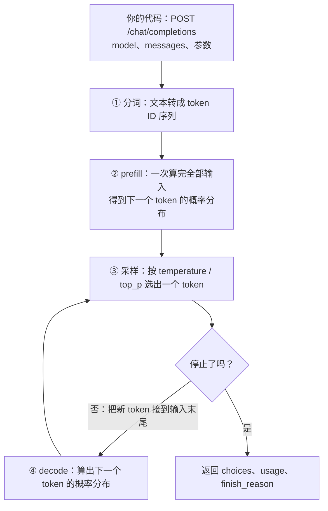

<Eyebrow>第 0001 课 · 约 30 分钟 · 动手 1 次命令</Eyebrow>

# 让模型说一句话，<br/>然后看懂它回了什么

<Lede>你的 26 周路径从这一条命令开始。今天只做一件事：发一次请求，读懂回应。</Lede>

## 为什么先学这个

你的目标里有两条硬要求，都卡在这一步：

- **「能独立设计、实现、评测、部署生产级 LLM Agent 应用」** ——
  所有 Agent 框架（LangChain、DSH、任何东西）内部都在做同一件事：
  *发一个 HTTP 请求，读一个 JSON*。把这层看透，框架对你就从「魔法」变成「取舍」。
- **面试会问。** 核实的真题里有「Harness 和 LangChain 的本质区别」——
  没自己调过原生 API 的人，这题只能背概念。

而且这一步你有个现成的优势：**你写过前端。** `fetch`、JSON、异步流 ——
这些对你是母语，只是还没指向新的端点。

## 现在就做：发一次请求

<Callout kind="do" title="复制粘贴，一行都别改">

```bash
# 1. 进实验区，加载 key
cd ~/Desktop/Personal/agent-lab/lab
set -a; . ./.env; set +a

# 2. 发请求
curl -s https://api.deepseek.com/chat/completions \
  -H "Content-Type: application/json" \
  -H "Authorization: Bearer $DEEPSEEK_API_KEY" \
  -d '{"model":"deepseek-flash",
       "messages":[{"role":"user","content":"用一句话解释什么是 KV Cache"}],
       "thinking":{"type":"disabled"}}' | python3 -m json.tool
```

</Callout>

你会看到一段 JSON。**先别往下读**，自己扫一眼，猜猜每个字段干什么用。

<Callout kind="warn" title="报错了怎么办">

**401 / Authentication Fails** → key 没读出来。跑 `echo ${#DEEPSEEK_API_KEY}`，
应该输出 `35`。输出 `0` 说明上面那行 `set -a; . ./.env; set +a` 没执行。

**Connection error** → 网络或代理。先跑 `curl -sI https://api.deepseek.com` 看通不通。

</Callout>

## 你刚才拿到的东西，逐块拆开

下面是**真实**的回应 —— 我替你跑过一次，字段一个没改：

```json
{
  "choices": [
    {
      "index": 0,
      "message": {
        "role": "assistant",
        "content": "KV Cache 是一种在自回归生成时缓存历史 token 的 Key/Value 张量、避免每步重复计算的推理加速技术。"
      },
      "finish_reason": "stop"
    }
  ],
  "usage": {
    "prompt_tokens": 10,
    "completion_tokens": 32,
    "total_tokens": 42,
    "prompt_tokens_details": { "cached_tokens": 0 },
    "prompt_cache_hit_tokens": 0,
    "prompt_cache_miss_tokens": 10
  }
}
```

### 真正重要的只有三块

| 字段 | 它回答什么问题 |
| --- | --- |
| `choices[0].message.content` | **答案是什么** —— 你要显示给用户的那句话 |
| `choices[0].finish_reason` | **这轮是怎么结束的** —— 决定你的代码接下来干什么 |
| `usage` | **花了多少** —— 你以后每次都要报的数字 |

## 为什么 `finish_reason` 比你想的重要

它**不是给模型看的，是给你看的**。你的代码要根据它决定下一步：

| 值 | 你的代码该做什么 |
| --- | --- |
| `stop` | 正常说完了 → 收工，把 content 给用户 |
| `length` | **被截断了** → 答案不完整。加大 max_tokens 或分段续写，*别当成功* |
| `tool_calls` | 模型想调工具 → 去执行，把结果发回去**再来一轮** |
| `content_filter` | 被内容策略拦了 → **别重试**，重试也没用 |
| `insufficient_system_resource` | 服务端资源不足 → **这个可以重试** |
| `aborted` | 被中断了 → 检查是不是你自己取消的 |

<Callout title="和你未来的工作直接相关">

你未来的用户会问：「为什么回答到一半停了？」
答不出 `finish_reason` 的工程师，只能回「可能是网络问题吧」。

</Callout>

## 关于 `usage` 里的数字

注意这条等式，它**永远成立**：

```text
prompt_tokens (10) = prompt_cache_hit_tokens (0) + prompt_cache_miss_tokens (10)
```

这次全是 **miss** —— 你第一次发这句话。`hit` 的部分便宜得多。
差多少、怎么才能命中，是后面某一课的内容。
今天只要记住：**这两个数字决定你的账单。**

## 原理：一次调用里发生了什么

你发出的请求，在服务端大致经过下面几步：



模型做的事情只有一件：在整个词表上给每个候选 token 打一个概率，然后取一个。它不是「读完整段话，再整体写出答案」，而是把这个循环重复很多次，每次只产生一个 token。停止有三种可能：模型输出结束符（`finish_reason` 为 `stop`），达到 `max_tokens`（为 `length`），或者模型决定调用工具（为 `tool_calls`）。

## 原理：分词 —— 计费和上下文都以 token 计

模型不认识字符，只认识整数。文本要先切成 token，每个 token 对应词表里的一个 ID。主流做法是字节对编码（BPE，见延伸阅读）：从单个字符出发，统计语料里最常相邻出现的片段，反复合并，直到词表达到设定的大小。

这个过程决定了三件事：

1. 常见的英文单词通常是一个 token，不常见的词会被拆成几块。
2. 中文的 token 数取决于词表对汉字的覆盖。我们用 `npm run probe:tokens` 测了一次，结果在下面的实验里。
3. 上下文窗口、价格、延迟和显存，全部按 token 计算，不按字数。所以估算成本要先估 token，不能直接数字数。

## 原理：上下文窗口与无状态

上下文窗口是单次请求里，输入加输出能容纳的 token 上限。DeepSeek-V3 的官方配置里，`max_position_embeddings` 是 163840（我们在第 1 章核对过 config.json）。这是位置编码支持的长度，不等于你在 API 上能用的长度：服务端的限制、价格、延迟都会影响实际可用的长度，以官方文档为准。

API 是无状态的（见下面实验的第 0 段）：模型不记得上一次的对话。所以「记忆」是客户端的工程问题：历史怎么保存、怎么裁剪、什么时候做摘要。第 7 章专门讲。书中第 1 章讨论 Agent 时，也把「记忆」当作独立组件来讲，这里借的是这种分工的概念。

## 原理：采样 —— 从概率分布里取一个 token

模型的输出层给出 logits：词表里每个候选 token 一个实数。采样分三步：

- **softmax**：把 logits 变成概率，公式是 `p_i = exp(z_i / T) / Σ_j exp(z_j / T)`，其中 T 就是 temperature。
  - T 越大，分布越平，低概率的词越容易被选中；
  - T 越小，分布越尖，越接近「总是选概率最大的那个」，也就是贪心。
- **top_p（核采样）**：把候选按概率从大到小排序，取累计概率首次达到 p 的最小集合，只在这个集合里按原概率重新归一化后采样。它截掉的是长尾。
- **组合**：两者可以同时用，但通常只调其中一个，否则很难判断是哪个参数起了作用。

还有两个容易被当作采样参数的字段，其实不是：`max_tokens` 只是输出上限，超过就截断；`thinking` 决定模型是否先生成一段推理内容再回答，推理内容同样计入输出 token。

| 参数 | 它改变的是 | 我们怎么看到效果 |
| --- | --- | --- |
| `temperature` | 分布的形状（采样的随机程度） | 下面实验第 3 段 |
| `top_p` | 候选集合的大小 | 本课只讲理论，没有实验 |
| `max_tokens` | 输出的上限 | 下面实验第 1 段 |
| `thinking` | 是否先推理，推理 token 计入输出 | 下面实验第 2 段 |

## 原理：为什么 temperature = 0 也不保证每次相同

理论上，T 趋近 0 时采样退化为取最大值，结果应该确定。但我们的实验里，temperature 为 0 时三次回答不一样（第 3 段）。常见的解释是：服务端的数值计算会有细微差异，并行执行的顺序也可能不同；这些差异在长序列里会被放大，最终改变某一步的选择。这是推测，我们没有验证。

实际意义是：如果你需要可复现的输出，不要依赖参数，要在你自己的任务上测。

## 实验：参数到底改变了什么

```bash
cd ~/Desktop/Personal/agent-lab/lab
npm run probe:sampling
```

这个脚本调真 API，花费几分钱。下面是我们跑的一次结果（摘了关键行）：

```text
0. 无状态：不带历史 → 不记得名字；带历史 → 记得；prompt_tokens 8 vs 35
1. max_tokens = 5 → finish_reason = length，completion_tokens = 5，内容被截断
2. 不传 thinking → reasoning_content 有 64 个字符，reasoning_tokens = 18，completion_tokens = 20
3. temperature = 0 → 三次回答不一样
   temperature = 1.5 → 三次回答也不一样，差异更大
```

读这些结果，有两件事值得注意：

- **thinking 默认是开着的。** 我们没有传 thinking 参数，模型还是先推理了 18 个 token。这些 token 计入 `completion_tokens`，也就是计入输出的账单。成本敏感的场景要显式关掉，或者按需打开。
- **temperature = 0 不等于每次都一样。** 我们的直觉是 temperature 为 0 时输出应该固定，但三次结果不同。我们只跑了一轮，样本很小，所以只能写成观察。原因我们没有验证。

<Callout kind="warn" title="我们的结果和直觉不一致">

如果你想依赖「temperature = 0 就能复现」，先在你自己的任务上测一次，不要直接相信。

</Callout>

## 实验：分词 —— 中文和英文各多少 token

```bash
cd ~/Desktop/Personal/agent-lab/lab
npm run probe:tokens
```

我们跑的一次结果：

```text
中文：20 字 → 35 tokens，60 字 → 99，120 字 → 197，240 字 → 385
      斜率约 1.59 token/字，截距约 4（模板开销）
英文：20 词 → 25 tokens，60 词 → 67，120 词 → 130，240 词 → 256
      斜率约 1.05 token/词，截距约 4
```

读法：

- 汉字不是随机抽的，而是从 U+4E00 起按固定步长取的，尽量避免重复，平均约 1.6 个 token/字。不同字的 token 数不一样，所以这是平均值。
- 英文词是 20 个常见词循环使用，平均约 1.05 个 token/词。英文一个词通常有 4 到 6 个字母，所以按字符算，英文的 token 效率高得多。这是按字符的粗略比较，不是对同一段话的严格比较。

## 面试映射

| 面试会问 | 这一节给你的答案 |
| --- | --- |
| 大模型 API 是有状态还是无状态？多轮对话怎么做？ | 无状态。客户端保存历史，每次整段发回。实验里，不带历史时模型不记得上一句。 |
| temperature 和 top_p 有什么区别？ | 都控制随机性。temperature 改变概率分布的形状，top_p 截断候选集合。一般只调一个。 |
| 为什么账单上的输出 token 比文字多？ | 开了 thinking 时，推理 token 也计入 `completion_tokens`。 |
| 为什么同样的内容，中文比英文更费 token？ | 按字符算，中文约 1.6 token/字，英文约 1.05 token/词。要按 token 估成本，不能数字数。 |
| 上下文窗口的单位是什么？ | token。计费、延迟和显存都按 token 算。 |

## 延伸阅读

- [Sennrich 等，Neural Machine Translation of Rare Words with Subword Units（BPE）](https://arxiv.org/abs/1508.07909)
- [Vaswani 等，Attention Is All You Need（Transformer）](https://arxiv.org/abs/1706.03762)
- [DeepSeek 多轮对话指南](https://api-docs.deepseek.com/guides/multi_round_chat)
- [DeepSeek 思考模式](https://api-docs.deepseek.com/guides/thinking_mode)
- [waylandz《AI Agent 架构模式与实战》第 1 章「Agent 的本质」（只借概念）](https://waylandz.com/ai-agent-book/)
## 检验一下

<Quiz
  n={1}
  of={3}
  q="finish_reason 这个字段是给谁看的？"
  options={['给模型自己判断要不要继续', '给你判断这轮是怎么结束的', '给计费系统算这次花多少钱']}
  answer={1}
  ok="对。它是控制流的开关 —— 你的代码根据它决定「收工 / 续写 / 调工具 / 重试」。"
  no="再想想。模型看不到这个字段（它是模型产出之后才确定的）；计费看的是 usage。它是给你 —— 调用方 —— 看的。"
/>

<Quiz
  n={2}
  of={3}
  q="如果把 finish_reason: length 当成成功，会发生什么？"
  options={['用户会看到前后矛盾的重复答案', '请求会被服务端直接拒绝掉', '用户会看到一段被腰斩的回答']}
  answer={2}
  ok="对。这是最常见的线上事故：回答到一半没了，但没有任何报错。用户只能说「回答怎么怪怪的」。"
  no="再想想。请求是成功的（HTTP 200），只是内容被 max_tokens 截断了。问题不在服务端，在你的处理逻辑。"
/>

<Quiz
  n={3}
  of={3}
  q="某次请求 prompt_cache_hit_tokens 很大，说明什么？"
  options={['你发的内容大部分命中缓存', '模型这次的回答变得很短', '你这次请求被服务端限流']}
  answer={0}
  ok="对。命中缓存的那部分便宜很多。所以「怎么让前缀稳定」是个省钱的真问题。"
  no="再想想。hit/miss 描述的是【你发过去的内容】有没有被缓存 —— 和模型回答多长无关（那是 completion_tokens），也和限流无关。"
/>

## 想再深入，读这一份

[DeepSeek 官方 API 参考 · Create Chat Completion](https://api-docs.deepseek.com/api/create-chat-completion)
—— 所有字段的权威定义。今天只读 `choices` 和 `usage` 两节，其余留着以后查。

<Callout kind="warn" title="一个已知陷阱">

文档里 **`thinking` 默认是开启的**。开着的时候 `temperature` 无效、
`max_tokens` 默认 64K、响应里会多出 `reasoning_content`。

今天我们在请求里显式关了它 —— **故意的**，让变量少一个。

</Callout>

## 下一课是什么

**第 0002 课 · 流式：为什么回答是一个字一个字蹦出来的** ——
同一句话，用 `stream: true` 再发一次。你会看到 SSE 协议，
以及一个大部分人第一次写都会踩的坑：*它会静默丢数据，不报错。*

<Callout title="在那之前，先确认今天的成果">

你应该已经看到了一段真实 JSON，并且能指着 `finish_reason` 说出它干什么用。

如果还没有 —— **那就还没到下一课**，回头把上面的命令跑通。

</Callout>
