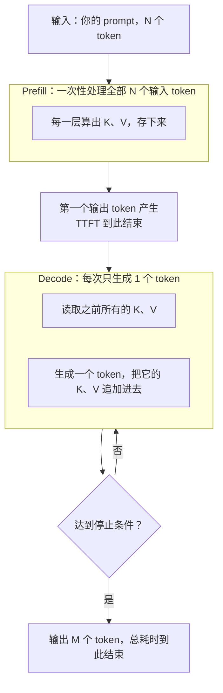

<Eyebrow>第 0005 节 · 约 45 分钟 · 动手 1 次实验</Eyebrow>

# 一次请求的两个阶段：<br/>TTFT 与吐字速度为什么是两回事

<Lede>第 0002 节你测过首字延迟（TTFT）。这一节解释它为什么会变，以及它为什么要和后面的吐字速度分开看。</Lede>

## 先猜一个数

<Callout kind="do" title="动手前先写下你的猜测">

输入从 30 个 token 涨到 30,000 个 token，首字延迟（TTFT）大概会涨几倍？
把你的猜测写在纸上，读完这一节再对照。

</Callout>

## 为什么要分开看

第 0002 节的参考实现在一次真实调用里测得首字约 712 ms。首字和总耗时的来源不同。

- **TTFT** 只回答一件事：第一个字什么时候出来。
- **总耗时** 还包含后面所有字的生成时间。

用户的感受也分两段。等第一个字时，他会想「卡住了吗」。字开始出来之后，他会想「快不快」。两段的瓶颈不一样，优化办法也不一样。

## 两个阶段

一次请求分两个阶段：



图里的 K、V 是注意力里的「键」和「值」—— 每个 token 在这两层产生的两份向量。它们是什么、为什么能存下来，第 0006 节开头专门讲。

把它写成两条式子：

- TTFT ≈ 网络与排队 + Prefill(N)
- 总耗时 ≈ TTFT + Decode(M)

所以：**输入变长，TTFT 变长；输出变长，总耗时变长，TTFT 不变。**

Decode 阶段通常受显存读写速度限制，这是业界的常见说法。这一节末尾有 decode 速度的实测。

## prefill 这个名字从哪来

prefill = **pre** + **fill**，预先填充。填的是 KV cache。

要生成第一个输出 token，模型必须先「看见」整段输入 —— 也就是每一层都得先有这 N 个 token 的 K 和 V。所以这一步必然发生在生成之前，名字就是这么来的。

对前端的类比：prefill 像**把整段输入一次性读进来、建好索引**；decode 像**每写一个字都回查一次索引**。

## 原理：这一次前向算出了两样东西

1. **每一层、每个输入 token 的 K 和 V** —— 存进 KV cache。这是「填充」的那部分。
2. **最后一个位置的输出向量** —— 过输出层（lm_head）得到整个词表上的概率分布，采样出**第一个输出 token**。

第 2 点容易被忽略：prefill 不只是「做准备」，它顺手就把第一个字产生出来了。所以 TTFT 在 prefill 结束时终止，而不是之后再单独算一次。

## 原理：为什么 N 个 token 能一次算完

所有 N 个输入 token 的 id 在请求到达时就全知道了，不用等谁。注意力里给每个位置加一个**因果遮罩**（第 i 个位置只能看到第 i 个及之前的位置），就能把整段输入当成一个大矩阵一次算完，结果和从头逐个算一遍完全一样。

这就是「prefill 能并行」的确切含义。decode 做不到，因为第 n+1 个 token 的 id 得等第 n 个采样出来才知道。

## 原理：一次 prefill 的五个步骤

1. **分词**：文本 → N 个 token id。
2. **查嵌入表**：每个 id → 一个向量。
3. **逐层计算**（61 层就重复 61 次）：这一层所有 N 个位置一起算 Q、K、V → 注意力（带因果遮罩）→ 前馈网络。
4. **取最后一个位置的输出向量** → lm_head → 词表上的 logits → softmax → 概率分布。
5. **采样**出第一个 token；把第 3 步算出的所有 K、V 留在缓存里，供后面 decode 使用。

第 3 步是一次大的矩阵乘法，显卡利用率高；第 4、5 步很轻。所以 prefill 的耗时几乎全在第 3 步，并且随 N 增长 —— 这就是第 0007 节要拆的那段预算。

## 实测：强制缓存 miss 的 TTFT 曲线

测 prefill，就必须避开缓存。第 0004 节学过：前缀一变，缓存必然 miss。所以每次请求都在 system 最前面放一个随机 nonce。

数据（每个点取 3 次中的最小值）：

| 输入 tokens | TTFT | 相对 33 tokens 增加 | 边际：每千 token 增加 |
| --- | --- | --- | --- |
| 33 | 350 ms | — | — |
| 2,334 | 542 ms | +192 ms | 83 ms |
| 9,234 | 941 ms | +591 ms | 58 ms |
| 28,034 | 1,864 ms | +1,514 ms | 49 ms |
| 73,036 | 3,644 ms | +3,294 ms | 40 ms |

<Callout kind="warn" title="数字的口径">

- 这是**单次会话**测的。绝对值会随时段漂移：两个只有二三十个 token 的短请求，在两次实验里分别是 757 ms 和 350 ms。
- 所以只看**相对关系**：输入越长，首字越晚；曲线越来越平。
- 这张表只有 5 个点。你的练习会测出一条自己的曲线，中间某一档可能反常，比如 800 行比 200 行还快。那是噪声，把重复次数从 3 改成 5 再看。

</Callout>

读这张表，有三件事值得注意：

1. 33 → 73K tokens，TTFT 放大了约 10 倍。输入长度确实是首字延迟的主要来源。
2. 前 2 千 token 的边际成本最高（83 ms/千 token），之后逐步下降到 40 ms/千 token。
3. 边际成本为什么递减，我们没有证据来解释。一种可能是批处理与并行效率随规模提高，但这只是推测。这一节不下结论。

## 从曲线读出三条推论

1. **首字延迟主要由输入决定**，加上网络和排队。输出长度不影响 TTFT。
2. **每次请求都要为完整的输入付一次 prefill**，除非命中缓存。所以第 0004 节的「稳定前缀」同时省钱，也省首字延迟。
3. **首字延迟有一个底座**，实测在 350 ms 上下，且随时段变化。能削的只是底座之上的那一截。

## 产出：测你自己的曲线

```bash
cd ~/Desktop/Personal/agent-lab/lab
npm run ex:ttft
```

这个命令会调真 API，总共约 0.2 元。文件 `exercises/02-inference/ttft-curve.ts` 已经建好，你只需要填两个 TODO：

- **TODO 1**：`measureOnce`，发一次流式请求，返回 TTFT 和 usage。复用你在 `stream.ts` 里写的缓冲区逻辑。
- **TODO 2**：`main`，对 5 个尺寸各跑 3 次，取最小 TTFT。

跑完会有一张表和一段自检。写完之后，把你的表贴给我，我看趋势。


## 原理：一次前向计算做了什么

Transformer 的每一层都有两个主要部分：注意力（每个位置从前面的位置收集信息），和前馈网络（FFN，对每个位置做一次非线性变换）。两者都带残差连接和归一化。模型的深度就是这样的层的堆叠（原始论文见延伸阅读）。

prefill 和 decode 的区别，来自输入的形状：

| | prefill | decode |
| --- | --- | --- |
| 每一层同时处理多少个 token | 全部输入，N 个 | 一步一个，1 个 |
| 矩阵形状（近似） | N × d 的大矩阵乘法 | 1 × d 的向量乘矩阵 |
| 主要特征 | 计算密集，GPU 利用率高 | 每一步都要读全部权重和 KV cache，常受显存带宽限制 |
| 能否并行 | 可以，输入已知 | 不能，第 n+1 个 token 依赖第 n 个 |

「decode 常受显存带宽限制」是业界的常见解释。我们测到的只是现象，没有做 profile。

## 原理：TTFT 为什么随输入长度增长

prefill 处理全部输入，所以 TTFT 的主要部分随输入长度增长。全量注意力的计算对长度 N 是 O(N²)；FFN 对 N 是线性的。哪一项占主导，取决于模型和长度范围。

我们的数据（第 0005 节的实验）可以做一个粗略的线性拟合：

`TTFT ≈ 468 ms + 44.4 ms × (输入的千 token 数)`

| 输入 token | 实测 TTFT | 拟合值 | 误差 |
| --- | --- | --- | --- |
| 33 | 350 ms | 469 ms | -119 ms |
| 2334 | 542 ms | 572 ms | -30 ms |
| 9234 | 941 ms | 878 ms | +63 ms |
| 28034 | 1864 ms | 1713 ms | +151 ms |
| 73036 | 3644 ms | 3711 ms | -67 ms |

在 33 到 73K token 的范围内，线性项占了主导，平方项还没有明显显现。这是推测，要验证需要更长的输入，或者更密的采样点。我们的边际成本也在下降（每千 token 从 83 ms 降到 40 ms），和「平方项主导」的直觉相反，原因我们没有查清。

## 原理：时间模型，以及一次验算

总耗时的粗略模型：

`T_total ≈ TTFT + (M - 1) × TPOT`，其中 M 是输出 token 数。

用第 0005 节 decode 实验的数据验算：短输入时，TTFT 的最小值是 409 ms，TPOT 的中位数是 8 ms，输出 256 个 token。模型预测：409 + 255 × 8 = 2449 ms。实测总耗时的中位数是 2703 ms，差了约 250 ms，约占实测的 9%。

误差有两个来源：模型用的是 TTFT 的最小值，偏乐观；TPOT 的测量受分块影响。模型足够做容量估算，但不能替代实测。

## 原理：为什么输出比输入贵

输入的 prefill 是并行的，输出的 decode 是串行的，而且每个输出 token 都要重新读一遍前面全部的 KV。所以在同样的 token 数下，输出的计算和访存成本都更高。这解释了为什么输出价格通常高于输入（具体价格以官网为准）。

## 原理：延迟不是唯一的指标 —— 吞吐

前面讲的都是「一个请求」的延迟。服务端真正被考核的还有另一个指标：**吞吐（throughput）**，单位时间能处理多少 token 或多少个请求。

两者方向相反：

- 一次只处理一个请求，延迟最低，但显卡大量时间在等显存，算力闲着。
- 一次把多个请求拼成一批（batching）处理，吞吐上去了，但每个请求要多等别人。

工程上常见的做法是 **continuous batching**（也叫 iteration-level scheduling）：不按「整批请求」为单位，而是按「每个 decode 步」为单位调度。一个请求生成完了，立刻有新请求补进来，不用等整批结束。PagedAttention 那篇论文里描述的就是这套调度（见延伸阅读）。

还有一个取舍是 **长 prefill 会挡住 decode**：一个 30K token 的输入在做 prefill 时，同一批里其他请求的 decode 都得等。常见的缓解办法是把长 prefill 切成小块插入调度（chunked prefill），这样单请求的首字会晚一点，但其他请求不会被卡住。这个做法我们没有实测，只作为工程常识提一句。

对你的实际意义：如果面试问「怎么提高吞吐」，答案不是「把 TTFT 优化到最低」，而是「提高批大小、用连续批处理、不要让长 prefill 独占」。这两件事经常要一起谈。

## 实验：decode 的代价（我们跑过了）

第 0005 节前面说，输出变长影响总耗时，不影响首字。我们用 `npm run probe:decode` 测了一次，两档各跑三次（TTFT 报最小值，其余报中位数）：

```text
max_tokens   输出 token   TTFT(最小)   每 token 时间(中位)   总耗时(中位)   finish
        16           16       755 ms              14 ms          1064 ms   length
       256          256       409 ms               8 ms          2703 ms   length
```

读这张表，有三件事：

- **总耗时随输出长度增长**：16 个 token 约 1064 ms，256 个约 2703 ms。这就是 decode 的代价。
- **TTFT 没有随输出变长而变长。** 但两档的数字是 755 ms 和 409 ms，单次测量的噪声比这个差异还大。结论只能是「TTFT 不依赖输出长度」，不能是「256 比 16 快」。
- **每个 token 的时间（14 ms 和 8 ms）我们没有解释。** 可能跟网络分块有关：一个 chunk 里可能包含多个 token，算出来的平均值会失真。这一点我们没有验证。

你可以自己跑一次 `npm run probe:decode`，把你的表和我们的放在一起比。趋势应该一致，绝对数字会不同。

## 面试映射

| 面试会问 | 这一节给你的答案 |
| --- | --- |
| TTFT 为什么随输入长度增长？ | prefill 要处理整段输入，计算和显存都随输入增长。 |
| prefill 为什么能并行，decode 为什么不能？ | prefill 的输入已知，可以做批量矩阵运算；decode 的第 n+1 个 token 依赖第 n 个。 |
| attention 的复杂度是多少？ | 全注意力对长度 N 是 O(N²)，FFN 对 N 是线性。哪一项占主导，取决于模型和长度。 |
| 怎么估算一次请求的总耗时？ | 用 TTFT 加上 (M-1) × TPOT。用实测值，不要用理论值。 |

## 延伸阅读

- [Attention Is All You Need（Transformer 原始论文）](https://arxiv.org/abs/1706.03762)
- [PagedAttention（vLLM，连续批处理的调度）](https://arxiv.org/abs/2309.06180)
## 检验一下

<Quiz
  n={1}
  of={3}
  q="输出从 16 个 token 变成 256 个 token，TTFT 会怎么变？"
  options={['变长很多，因为要生成更多字', '基本不变，TTFT 主要由输入决定', '变短，因为模型有更多时间']}
  answer={1}
  ok="对。TTFT 结束于第一个输出 token 产生的那一刻，它只依赖 prefill。输出变长影响的是总耗时。"
  no="再想想。TTFT 结束于第一个输出 token 产生的那一刻。那一刻之后的 token 数，不会改变它。"
/>

<Quiz
  n={2}
  of={3}
  q="第 0005 节的曲线显示：从 33 tokens 到 73K tokens，TTFT 大约放大了多少倍？"
  options={['约 2 倍', '约 10 倍', '约 100 倍']}
  answer={1}
  ok="对。350 ms 到 3,644 ms，大约 10 倍。输入规模增长了两千多倍，TTFT 只增长了十倍，因为存在一个固定的底座。"
  no="再想想。把两个数字相除：3644 ÷ 350。"
/>

<Quiz
  n={3}
  of={3}
  q="如果你想降低一个长 system prompt 应用的首字延迟，最直接的手段是？"
  options={['把输出 max_tokens 调小', '缩短输入，并让前缀稳定以命中缓存', '换一个更慢的模型']}
  answer={1}
  ok="对。输入是 prefill 的成本。缩短它，或者让它命中缓存，都能直接降低 TTFT。"
  no="再想想。TTFT 主要由输入决定，所以要从输入下手。"
/>

<Callout kind="good" title="下一节">

第 0006 节：KV Cache 到底占多少显存。你会手算一次长上下文需要的显存，并看到 MLA 为什么能省下很多。

</Callout>
