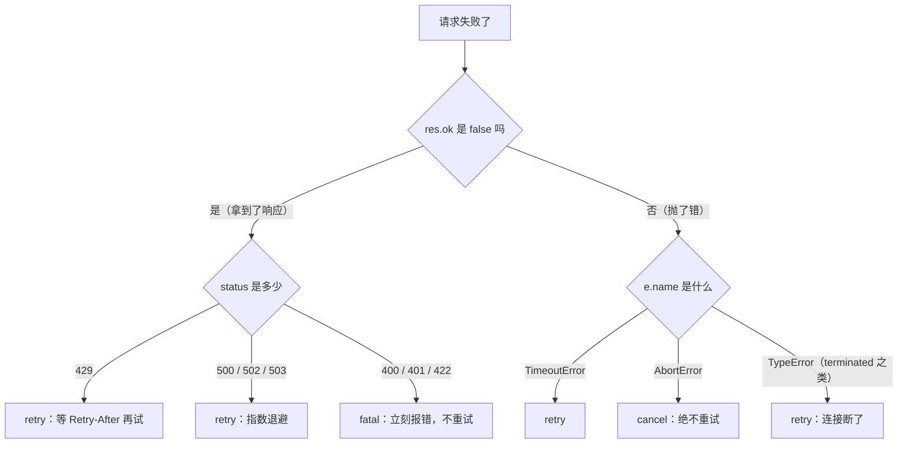

<Eyebrow>第 0008 节 · 约 40 分钟 · 动手 2 次实验 + 写一个客户端</Eyebrow>

# 能扛的客户端：<br/>先分清一次失败到底是谁的错

<Lede>第 0 章的调用是「一次就成功」。这一节处理它偶尔失败的时候：哪些错该重试，哪些错重试只会更糟。</Lede>

## 上线之后才会见到的失败

前几节的请求几乎都成功了，因为你在本地、在空闲时段、一次只发一个。上线之后会变成这样：

- 用户点了一次，请求撞上限流，服务端回 429。
- 服务端某个节点挂了，回 500。
- 网络抖了一下，连接在读到一半时断开。
- 你设了 10 秒超时，这次它用了 11 秒。

这四种情况看起来都是「失败」，但**它们该被怎么处理完全不同**。对 429 立刻重试，至少是无用功，还可能让限流窗口延长；对「用户已经取消」的请求重试，是在无视用户。

这一节先搞清楚「怎么分辨」，再写「怎么处理」。

## 动手：先让服务器按你的意思失败

本地有一个**故障注入服务器**，它的作用不是正常返回，而是按你的要求故意失败。用它测重试，既不花钱，也可以无限次跑。

```bash
cd ~/Desktop/Personal/agent-lab/lab

# 终端 1：启动故障服务器（默认 39002 端口）
npm run fault:server

# 终端 2：看四种失败各自抛什么
npm run probe:resilience
```

它会依次打 429、500、慢响应、断流、中途取消，并把每一次真实抛出的错误打印出来。

如果启动时提示端口 39002 被占用，先跑 `npm run fault:reset` 释放它。

## 实测：一次失败，六种身份

开头那四种情况只是举例。把实测结果整理全，一共六种身份。

下面是我们跑 `npm run probe:resilience` 的结果（节选关键行）：

```text
429（带 Retry-After）   ✅ res.ok=false status=429 Retry-After=1（fetch 不抛错，要自己判断）
500                    ✅ res.ok=false status=500
慢响应 2000ms，超时 300ms ❌ TimeoutError: The operation was aborted due to timeout (code=23)
请求阶段就取消           ❌ AbortError: This operation was aborted (code=20)
断流（服务器中途断）      ✅ 读到 426 字节后抛错 → TypeError: terminated
已 abort 的 signal 再请求 ❌ AbortError（1 ms 就抛，不会真的发出去）
```

把这些整理成一张表：

| 你看到的 | 它到底是什么 | 该怎么办 |
| --- | --- | --- |
| `res.ok === false`，status 429 | 被限流 | 重试，但要等 `Retry-After` |
| `res.ok === false`，status 500/502/503 | 服务端故障 | 重试 |
| `res.ok === false`，status 400/401/422 | **你发错了** | **不要重试** |
| `e.name === 'TimeoutError'` | 太慢了 | 重试 |
| `e.name === 'AbortError'` | **用户或你自己取消的** | **不要重试** |
| `e instanceof TypeError`，message 含 `terminated` | 连接断了 | 重试 |

两个最反直觉的点：

1. **`fetch` 对 429 和 500 不抛错。** 它只把 `res.ok` 设成 false，你得自己判断、自己抛。很多人的客户端在这里「静默成功」——把那个错误 JSON 当成正常回答显示给用户，界面上看起来一切正常，实际一句有效内容都没有。
2. **超时和取消抛出的是两种不同的错误。** `TimeoutError` 和 `AbortError` 名字不同，这就是你能区分它们、并决定「要不要重试」的唯一依据。

## 原理：分类是重试的前提

重试不是「失败了再来一次」，而是「**这个失败，再来一次有可能不一样**」。

按这个标准分三类：

- **retry（可重试）**：超时、限流、5xx、连接断开。它们都是**暂时性**的，过一会儿可能就好了。
- **fatal（不该重试）**：400、401、422、参数错误。同一份请求再发一百次，结果都一样，只会浪费时间。
- **cancel（不许重试）**：用户按了停止。重试等于「我听见你说停，但我继续」。

拿到一个错误之后，按这个顺序判断：



这张图的顺序很重要：**先看有没有拿到响应**（决定看 status 还是看错误名），再看具体值。写代码时也按这个顺序，不会漏。

<Callout kind="warn" title="重试还有一个隐藏前提">

重试意味着**同一个操作可能被执行两次**。查询天气无所谓，但「扣款」「发消息」「写文件」重试就可能变成扣两次款、发两条消息。

这类操作必须先保证**幂等**（重复执行和一次执行结果相同），或者干脆不重试、改成让用户重来。这门课的工具调用都假设无副作用，但你要记住这个前提。

</Callout>

## 原理：退避、抖动、Retry-After

重试的时机有三个讲究：

**① 要退避，不能连发。** 立刻重试等于把一次失败变成三次，服务端还没缓过来就被打得更狠。常用指数退避：

```text
第 1 次重试等 200 ms
第 2 次重试等 400 ms
第 3 次重试等 800 ms
第 n 次重试等 200 ms × 2^(n-1)
```

**② 要加抖动。** 如果一万个客户端都在第 200 ms 同时重试，你会造出一个新的尖峰。所以实际等待时间要加随机量，比如在 `0.8×` 到 `1.2×` 之间随机。这叫 jitter。

**③ `Retry-After` 要听。** 429 响应通常带一个 `Retry-After: 1`，意思是「1 秒后再来」。这是服务端在明确告诉你什么时候可以再试，比你猜的退避更准。有它就优先用它。

还要有一个**总预算**：所有重试加起来最多等多久（比如 5 秒）。没有上限的重试，在服务端彻底挂掉时会让你的请求挂在那里好几分钟。

实现上就是累加：

```text
已等待 = 0
每次要等 d 之前先判断：
  如果 已等待 + d > 5 秒 → 放弃，把这个错误抛给上层
  否则 等 d，已等待 += d
```

## 原理：超时不是一个数字就够

`AbortSignal.timeout(ms)` 是一个从创建那一刻开始算的**总计时器**。它测量的不是「多久没有数据」，而是「多久之内必须完成」。

最小的用法是这样：

```ts
// 5 秒内必须完成，否则中止
const res = await fetch(url, {
  method: 'POST',
  headers: { 'Content-Type': 'application/json' },
  body: JSON.stringify(payload),
  signal: AbortSignal.timeout(5000),
})
```

超时时抛出的是 `TimeoutError`（不是 `AbortError`），这一点前面那张表里已经写了。

这两个对不上：

- **非流式请求**：总计时器够用。反正要等完整结果。
- **流式请求**：用总计时器会误杀。一个正常的长回答可能要 30 秒，但如果它中间 5 秒没有任何数据，那才是真出问题了。

所以流式请求更适合**空闲超时**（idle timeout）：每次收到数据就把计时器重置，连续 N 秒没有新数据才判超时。`AbortSignal.timeout` 做不到这件事，得自己用 `setTimeout` + `controller.abort()` 实现。这一节先给出总计时器的版本，空闲超时留到第 5 章做流式界面时再补。

## 实验：重试到底能救回多少

假设每个请求有 50% 的概率失败（本地故障服务器用 `unstable&rate=0.5` 模拟），跑 40 次：

```bash
npm run probe:retry-gain
```

（这个实验同样要先启动故障服务器，在另一个终端跑 `npm run fault:server`。）

我们的结果：

```text
最多尝试次数   成功次数 / 总次数    实测成功率   理论成功率 1−p^n
           1         20 / 40          50%         50.0%
           3         36 / 40          90%         87.5%
           5         38 / 40          95%         96.9%
```

读法：

表里最后一列 `1−p^n` 是理论值：一个请求尝试 n 次全都失败的概率是 `p^n`（每次独立），所以「至少成功一次」的概率就是 `1−p^n`。实测会在理论值附近浮动，样本越大越接近。

- 不重试，一半的请求失败。
- 允许 3 次，成功率到 90%。
- 再往上收益迅速变小（3 次到 5 次只多了 5 个百分点），而每次失败都要等更久。

**所以重试次数不是越多越好。** 常见的实践是 2–4 次，配一个总时间预算。

## 原理：重试的代价

成功率上去的代价，前面那句提示已经写了：

- **延迟**：失败的那次要多等 200–800 ms 才重试。
- **并发占用**：一次请求在重试期间一直占着一个连接和一个槽位。
- **雪上加霜**：服务端已经过载，你还在重试，等于帮着压垮它。

所以常见的做法是「**重试 + 熔断**」一起上。

> **熔断**（circuit breaker）：连续失败 N 次之后，**直接拒绝**后续请求一段时间，连试都不试；过一段时间再放一两个请求去试探。

它和重试是一对互补的机制：重试提高**单次请求**的成功率，熔断防止你在服务端已经挂掉时**继续加压**。这一节不实现熔断，但你要知道它是重试的必要搭档。

## 你的产出

把这一节的内容做成一个能跑的客户端：

```bash
cd ~/Desktop/Personal/agent-lab/lab
npm run fault:server     # 终端 1
npm run ex:client        # 终端 2
```

`exercises/03-resilience/client.ts` 里有三个 TODO：

1. `classify()` —— 把错误分成 retry / fatal / cancel。
2. `callOnce()` —— 发一次请求，自己判断非 2xx 并抛错。
3. `callWithRetry()` —— 按分类重试，遵守 `Retry-After`，指数退避加抖动，有总预算。

自检会验 10 项，包括「用户取消后一次都不重试」和「400 不重试」。全部通过就说明这个客户端真的能扛。

## 面试映射

| 面试会问 | 这一节给你的答案 |
| --- | --- |
| 你怎么保证 LLM 服务的可用性？ | 分类失败后再重试：只重试暂时性错误，400 这类不重试；退避加抖动，遵守 Retry-After，有总预算。 |
| 429 和 500 该怎么处理？ | 都重试，但 429 要等 Retry-After 指定的时间。fetch 不会为它们抛错，得自己判断 `res.ok`。 |
| 超时怎么设？ | 非流式用总计时器；流式用空闲超时，否则会误杀正常的长回答。 |
| 重试有什么风险？ | 放大流量、增加延迟、占用并发；对非幂等操作会造成重复副作用。 |

## 延伸阅读

- [waylandz《AI Agent 架构模式与实战》第 42 章「Agent 超时与 Watchdog」](https://waylandz.com/ai-agent-book/)
- [MDN：AbortSignal.timeout()](https://developer.mozilla.org/en-US/docs/Web/API/AbortSignal/timeout_static)
- [MDN：AbortSignal.any()](https://developer.mozilla.org/en-US/docs/Web/API/AbortSignal/any_static)
- [RFC 9110：Retry-After 头](https://www.rfc-editor.org/rfc/rfc9110.html#field.retry-after)

## 检验一下

<Quiz
  n={1}
  of={3}
  q="请求返回了 400。你的客户端应该怎么办？"
  options={['立刻重试，说不定下一次就好了', '不重试，因为同一份请求再发也是 400', '等 1 秒再重试一次试试']}
  answer={1}
  ok="对。400 说明请求本身有问题（参数错、格式错），重发不会变好。要重试的是「过一会儿可能变好」的错误。"
  no="再想想。400 是「你发的东西不对」，不会因为时间过去而变化。"
/>

<Quiz
  n={2}
  of={3}
  q="为什么 `fetch` 收到 500 不会抛错？"
  options={['因为它只关心网络层，HTTP 状态要自己判断', '因为 500 是正常响应，不算错误', '因为 Node 的 fetch 有 bug']}
  answer={0}
  ok="对。`fetch` 只在网络层失败（连不上、断流、超时）时抛错。HTTP 层面 4xx/5xx 都会正常返回一个 Response，`res.ok` 为 false，判断的责任在你身上。"
  no="再想想。500 当然算错误，只是 `fetch` 不替你做这个判断。"
/>

<Quiz
  n={3}
  of={3}
  q="重试次数从 3 次加到 5 次，成功率从 90% 涨到 95%。该不该加？"
  options={['当然加，成功率越高越好', '要看代价：失败请求要多等几轮，还多占并发，通常 2–4 次就够', '应该加到 10 次，直到 100%']}
  answer={1}
  ok="对。收益是递减的（3→5 只多 5 个百分点），而每次失败都要多等一轮退避、多占一会儿连接。还要配合总时间预算。"
  no="再想想。成功率的提升不是免费的，代价是延迟和并发。"
/>
