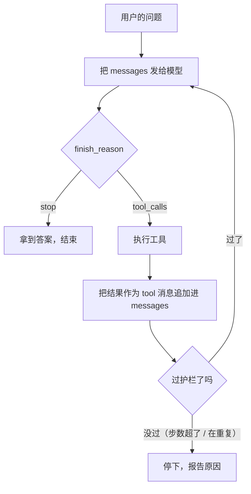

<Eyebrow>第 0010 节 · 约 30 分钟 · 读 1 段真实响应</Eyebrow>

# Agent 是什么：<br/>模型开始「自己做决定」的那一刻

<Lede>第 0–2 章你一直在「发一次请求、拿一次回答」。这一节讲清楚：这段代码要变成什么样子，才配叫 Agent。</Lede>

## 同一个问题，两种回答

问「北京今天天气怎么样？」。

**不给工具**：模型只能凭训练数据回答。它没有联网能力，也不知道此刻的天气，所以 `finish_reason` 是 `stop`，`content` 是一段文字。

**给了工具**：它不再直接回答，而是交回来一个**请求**。

## 模型交回来的不是答案，是一个请求

这是我们真实调 API 拿到的响应（节选，一个字段都没改）：

```json
{
  "choices": [
    {
      "index": 0,
      "message": {
        "role": "assistant",
        "content": "",
        "tool_calls": [
          {
            "index": 0,
            "id": "call_00_IpFmeEU5BEM70nCTvh4F0532",
            "type": "function",
            "function": {
              "name": "get_weather",
              "arguments": "{\"city\": \"北京\"}"
            }
          }
        ]
      },
      "finish_reason": "tool_calls"
    }
  ]
}
```

三个细节值得盯住：

- `content` 是**空字符串**，不是答案。
- `finish_reason` 是 **`tool_calls`**，不是 `stop`。这就是「这一轮没有结束，它在等我干活」的信号。
- `arguments` 是**字符串** `"{\"city\": \"北京\"}"`，不是对象。

模型不会自己去调天气接口。**它只是说「请帮我调 get_weather，参数是这些」。** 执行发生在你的代码里。

## 四个零件

一个 Agent 由四样东西组成，缺一样就退化成别的东西：

| 零件 | 在这个场景里是什么 | 缺了会怎样 |
| --- | --- | --- |
| **大脑** | LLM | 没有推理能力，只能执行死规则 |
| **手脚** | `tools` 定义 + 你写的执行函数 | 它只能「说」，不能「做」 |
| **记忆** | `messages` 数组，每轮整段发回去 | 它忘了上一轮发生了什么 |
| **主见** | 谁决定下一步做什么 | 见下一节 |

前三样你都已经见过了：大脑是第 0 章的 API，手脚是第 0003 节的工具调用，记忆是第 0001 节的「无状态」。

**第四样才是分水岭。**

## 聊天、工作流、Agent 的分界线

| | 谁决定下一步 | 长什么样 |
| --- | --- | --- |
| **聊天** | 人 | 你问一句，它答一句。下一步由你决定。 |
| **工作流** | 代码 | 「先检索，再总结，再翻译」——顺序在代码里写死，模型只是其中一步的执行者。 |
| **Agent** | 模型 | 它决定要不要调工具、调哪个、调几次、什么时候停。你的代码只负责执行和兜底。 |

这不是文字游戏，它决定了代码结构：

- 工作流的代码是**直线**：A → B → C，步骤数量固定。
- Agent 的代码是**循环**：做一步，问模型「下一步呢」，再做一步，直到模型说「完了」。

## 所以，Agent 的本质是一个循环



这个循环加上「工具」和「护栏」，就是所有 Agent 框架的核心。LangChain、DSH、任何名字的框架，剥掉外壳都是这张图。

后面几章都是在这个循环上加东西：

- 第 4 章：让模型在循环里「先想再做」（ReAct）。
- 第 5 章：把这个循环画到界面上。
- 第 11 章：给循环加权限、沙箱、检查点。

## 面试映射

| 面试会问 | 这一节给你的答案 |
| --- | --- |
| Agent 和普通 LLM 调用有什么区别？ | 普通调用是一次问答；Agent 是「模型自己决定下一步」的循环，能调工具、能多轮。 |
| Agent 和 workflow 有什么区别？ | 谁决定下一步。workflow 的顺序写死在代码里；Agent 的顺序由模型在运行时决定。 |
| Agent 通常由哪几部分组成？ | 大脑（模型）、手脚（工具）、记忆（消息历史）、主见（由模型决定下一步）。 |

## 延伸阅读

- [waylandz《AI Agent 架构模式与实战》第 1 章「Agent 的本质」](https://waylandz.com/ai-agent-book/)
- [Datawhale《Hello-Agents》第一章「初识智能体」](https://datawhalechina.github.io/hello-agents/)
- [Anthropic：Building effective agents（工作流 vs Agent 的划界）](https://www.anthropic.com/engineering/building-effective-agents)

## 检验一下

<Quiz
  n={1}
  of={3}
  q='模型返回 `finish_reason: "tool_calls"`，说明什么？'
  options={['这轮结束了，直接用 content 回答用户', '这轮没结束，模型在请求你执行工具', '模型出错了，要重试']}
  answer={1}
  ok="对。`tool_calls` 表示「我要调工具，请帮我执行」，而不是结束。结束是 `stop`。"
  no="再想想。结束的信号是 `stop`；`tool_calls` 是「还有下一步」。"
/>

<Quiz
  n={2}
  of={3}
  q="下面哪个是 Agent，而不是工作流？"
  options={['写死：先检索 → 再总结 → 再输出', '模型自己决定要不要检索、检索几次、什么时候停', '用户手动点三次按钮']}
  answer={1}
  ok="对。区别在「谁决定下一步」：工作流由代码写死，Agent 由模型在运行时决定。"
  no="再想想。看「下一步做什么」是谁决定的。"
/>

<Quiz
  n={3}
  of={3}
  q="为什么每一轮都要把完整的 messages 发回去？"
  options={['因为 API 要求至少 3 条消息', '因为服务端不保存上一次的对话，是无状态的', '为了让账单更高']}
  answer={1}
  ok="对。第 0001 节实测过：不带历史，模型就不记得上一句。记忆是你这边的责任。"
  no="再想想。第 0001 节做过实验：不带历史的第二次请求，模型不知道你叫什么。"
/>
